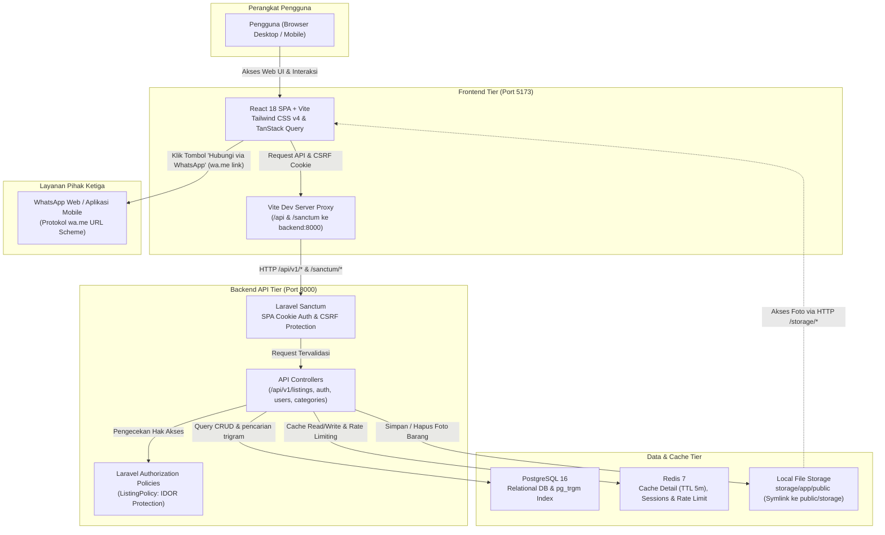

# Arsitektur Aplikasi

Dokumen ini menjelaskan rancangan arsitektur aplikasi **PasarWarga** (Marketplace Barang Bekas Komunitas), alur interaksi pengguna, komponen sistem, dan integrasi layanan eksternal.

---

## 1. Diagram Alur Aplikasi

Diagram berikut menggambarkan alur interaksi mulai dari pengguna (browser), Frontend SPA, Backend REST API, database PostgreSQL, cache Redis, penyimpanan berkas lokal, hingga layanan eksternal WhatsApp.

---

## 2. Penjelasan Komponen Aplikasi

### A. Frontend (Klien SPA)
- **Teknologi**: React 18, TypeScript, Vite, Tailwind CSS v4, React Router, dan TanStack Query (React Query).
- **Peran**: Menyajikan antarmuka pengguna responsif (mobile-first), menangani routing sisi klien, validasi formulir awal dengan Zod, serta mengelola state data caching di browser.
- **Komunikasi**: Menggunakan instance Axios dengan konfigurasi `withCredentials: true` untuk mengirimkan cookie sesi Sanctum dan header `X-XSRF-TOKEN` secara otomatis.
- **Proxy Development**: Vite dev server mem-proxy permintaan yang diawali `/api`, `/sanctum`, dan `/storage` langsung ke container backend (`http://backend:8000`), sehingga terhindar dari kendala CORS pada lingkungan pengembangan lokal.

### B. Backend REST API
- **Teknologi**: Laravel 12 (PHP 8.3) berjalan di server built-in / PHP-FPM port 8000.
- **Routing API**: Seluruh endpoint RESTful dikelompokkan dalam prefiks versi `/api/v1`.
- **Autentikasi (Sanctum SPA Cookie)**:
  - Menggunakan sesi berbasis cookie HTTP-only (`marketplace_barang_bekas_session`), disimpan di Redis.
  - Mengamankan mutasi state (`POST`, `PUT`, `PATCH`, `DELETE`) dari serangan Cross-Site Request Forgery (CSRF) via endpoint `/sanctum/csrf-cookie`.
- **Otorisasi & Keamanan**:
  - `ListingPolicy` menjamin kepemilikan data (mencegah IDOR saat pengguna mengedit, menghapus, atau menandai status barang).
  - Validasi form request yang ketat (`StoreListingRequest`, `UpdateListingRequest`) dengan validasi kepemilikan ID foto saat edit.
- **Rate Limiting**:
  - Endpoint autentikasi (`/api/v1/auth/register`, `/api/v1/auth/login`) dibatasi 5 percobaan per menit per kombinasi IP dan email untuk mencegah brute-force.
  - Endpoint upload (`POST /api/v1/listings`) dibatasi 20 upload per jam per pengguna untuk mencegah flooding berkas.

### C. Database (PostgreSQL 16)
- **Peran**: Penyimpanan relasional persisten data pengguna, kategori barang, katalog listing, dan relasi foto barang.
- **Pencarian Teks**: Memanfaatkan ekstensi native `pg_trgm` dengan indeks GIN (`gin_trgm_ops`) pada kolom `title`. Hal ini mendukung pencarian parsial cepat (`ILIKE`) tanpa memerlukan service search engine eksternal.
- **Optimasi Indeks**:
  - Indeks komposit `(status, category_id, created_at)` untuk filtering katalog beranda.
  - Foreign key indeks pada `listings.user_id` dan `listing_images.listing_id`.

### D. Cache & Session Store (Redis 7)
- **Cache Data**: Endpoint detail barang (`GET /api/v1/listings/{id}`) di-cache dengan kunci `listings:detail:{id}` dan TTL 5 menit. Cache otomatis di-invalidate saat listing di-update, dihapus, atau diubah statusnya.
- **Session Driver**: Digunakan sebagai shared session store lintas instance backend.
- **Rate Limiter Storage**: Menyimpan counter throttle IP dan user secara in-memory untuk performa sub-milidetik.

### E. Penyimpanan Foto (Local Disk Storage)
- **Penyimpanan Lokal**: Berkas foto diunggah ke `storage/app/public/listings/` dan dipetakan ke web root via symbolic link `public/storage`.
- **Abstraksi Laravel Storage**: Menggunakan facade `Storage::disk(config('filesystems.default'))` sehingga di lingkungan produksi dapat langsung dialihkan ke Cloudflare R2 / AWS S3 hanya dengan mengubah konfigurasi environment tanpa mengganti kode aplikasi.

### F. Integrasi Layanan Eksternal (WhatsApp)
- **Mekanisme**: Direct deep link menggunakan protokol URL scheme standar `https://wa.me/{phone}?text={encoded_message}`.
- **Keunggulan**:
  - **Zero Server Overhead**: Tidak ada panggilan ke API eksternal, tidak memerlukan webhook, dan tidak ada biaya langganan gateway chat.
  - **Pesan Otomatis**: Pesan awal langsung terisi judul barang dan harga Rupiah secara otomatis ketika aplikasi WhatsApp pembeli terbuka.
  - **Privasi & Keamanan**: Percakapan negosiasi dan transaksi COD berlangsung langsung secara end-to-end terenkripsi di WhatsApp pengguna.

---

## 3. Alur Permintaan Utama (Request Lifecycle)

1. **Inisialisasi Sesi Pengguna**:
   - Browser memanggil `GET /sanctum/csrf-cookie` untuk memperoleh cookie `XSRF-TOKEN`.
   - Pengguna melakukan login via `POST /api/v1/auth/login`. Backend memverifikasi hash kata sandi (bcrypt) dan menyuntikkan cookie `httpOnly` sesi.
2. **Katalog & Filter Pencarian**:
   - Pengguna mengetik pencarian di beranda (debounced 400 ms) atau memilih filter kategori/kondisi.
   - TanStack Query mengirimkan `GET /api/v1/listings?q=...&category=...&condition=...&sort=...&page=...`.
   - Laravel memproses query PostgreSQL dengan GIN index trigram dan indeks komposit, lalu mengembalikan data JSON terpaginasi.
3. **Pemuatan Detail Barang**:
   - Pengguna membuka kartu barang `/listings/{id}`.
   - Backend mengecek kunci cache Redis `listings:detail:{id}`. Jika cache miss, backend mengambil relasi eager loading (`user`, `category`, `images`) dari PostgreSQL, menyimpan ke Redis (TTL 5m), dan mengembalikan response.
4. **Pasang & Update Barang**:
   - Penjual mengunggah foto dan formulir barang via `POST /api/v1/listings` (multipart/form-data).
   - Validasi Form Request memeriksa ukuran maksimal 2 MB per foto (maks 5 foto) dan tipe MIME yang diizinkan (JPG, PNG, WebP).
   - Backend menyimpan foto ke storage disk, menulis record transaksi ke PostgreSQL, dan menginvalidasi cache listing terkait.
5. **Penghubung WhatsApp**:
   - Pembeli mengklik tombol "Hubungi via WhatsApp" pada detail barang yang masih tersedia.
   - Frontend membuka tab baru ke tautan `wa.me` dengan teks template otomatis.
