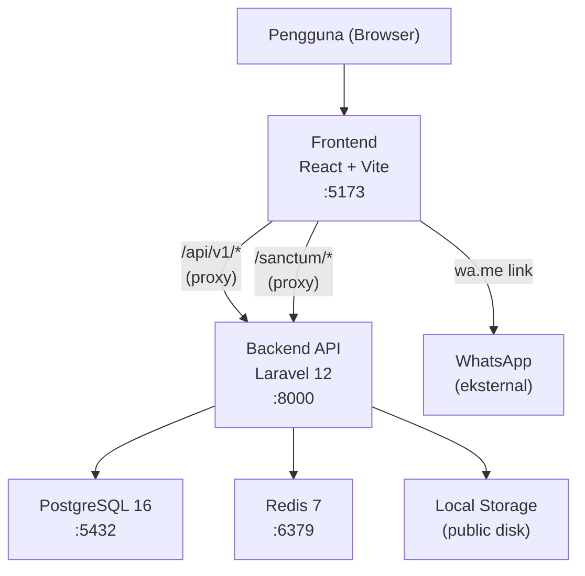

# Arsitektur Aplikasi (Development)

Diagram berikut menggambarkan arsitektur aplikasi dalam lingkungan development menggunakan Docker Compose.

## Diagram

## Penjelasan Komponen

| Komponen | Teknologi | Port | Keterangan |
|----------|-----------|------|------------|
| Frontend | React 18 + Vite + TypeScript | 5173 | SPA, Tailwind CSS v4 |
| Backend API | Laravel 12, PHP 8.3 | 8000 | REST API `/api/v1`, Sanctum SPA auth |
| Database | PostgreSQL 16 | 5432 | Primary datastore, pg_trgm untuk search |
| Cache | Redis 7 | 6379 | Cache, session, rate limiting |
| Storage | Local disk (`storage/app/public`) | — | Foto listing, via symlink `public/storage` |
| WhatsApp | Eksternal (wa.me) | — | Deep link, tidak ada server-side call |

## Alur Request Utama

1. **Browser** membuka `http://localhost:5173` → Vite dev server melayani React SPA.
2. **React** melakukan fetch ke `/api/v1/*` → Vite proxy meneruskan ke `http://backend:8000`.
3. **Laravel** memproses request: autentikasi via Sanctum cookie, query ke PostgreSQL, cache ke Redis.
4. **Response JSON** dikembalikan ke React, state diupdate via TanStack Query.
5. Untuk kontak penjual: React membuka link `wa.me/...` di tab baru — tidak ada server call.

## Docker Compose Network

Semua service berada dalam satu Docker network `marketplace_network`. Frontend dapat menjangkau backend via hostname `backend`, backend menjangkau database via `postgres`, dan Redis via `redis`.

> Lihat [`../docker-compose.yml`](../docker-compose.yml) untuk konfigurasi lengkap.
