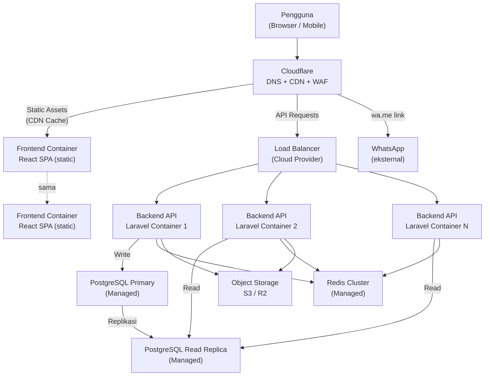

# Arsitektur Infrastruktur Produksi

> ⚠️ **Catatan**: Bagian ini adalah **rancangan** untuk infrastruktur produksi skala ±100.000 DAU. Infrastruktur ini **tidak dibangun** dalam assignment ini — hanya didokumentasikan sebagai bagian dari desain teknis.

## Diagram

## Komponen Produksi

| Komponen | Layanan | Keterangan |
|----------|---------|------------|
| CDN / WAF | Cloudflare | Cache static assets, DDoS protection, WAF rules, SSL termination |
| Load Balancer | Cloud provider (GCP/AWS/Azure) | Distribute traffic ke multiple backend instance |
| Backend | Container (Kubernetes / Cloud Run) | Horizontal scaling, auto-scaling berdasarkan CPU/RPS |
| Frontend | Static files via CDN | Build artifact di-upload ke Cloudflare Pages / S3 + CloudFront |
| Database | Managed PostgreSQL | Primary untuk write, read replica untuk query baca |
| Cache | Managed Redis | Session, cache, rate limiting — shared across all backend instances |
| Object Storage | Cloudflare R2 / AWS S3 | Foto listing, CDN delivery via Cloudflare |

## Strategi Scaling

Detail lengkap ada di [`scaling-reliability.md`](./scaling-reliability.md).

- **Backend**: Horizontal scale container, stateless (session di Redis, storage di S3).
- **Database**: Read replica untuk query listing (heavy read workload). Connection pooling via PgBouncer.
- **Cache**: Redis di-share semua instance untuk invalidasi cache yang konsisten.
- **Static assets**: Frontend SPA di-serve via CDN — tidak ada beban ke server untuk HTML/JS/CSS.
- **Search**: `pg_trgm` cukup untuk MVP; migrasi ke Meilisearch/Typesense jika > 1M listing.
