# Arsitektur Infrastruktur (Skala ±100.000 DAU)

Dokumen ini menguraikan asumsi rancangan arsitektur infrastruktur untuk mendukung target **±100.000 Daily Active Users (DAU)**.

> ⚠️ **Pernyataan Batasan MVP**:
> Seluruh infrastruktur produksi berbayar/cloud (Cloudflare CDN/WAF, Managed Database dengan Read Replica, Object Storage S3/R2, PgBouncer, dan Kubernetes Autoscaler) adalah **rancangan teknis** dan **tidak dibangun** pada lingkungan lokal MVP. Lingkungan MVP berjalan secara mandiri dan utuh di **Docker Compose**.

---

## 1. Diagram Infrastruktur Produksi (Target 100k DAU)

Diagram berikut menampilkan pemisahan batas keamanan (VPC Public vs Private Subnet), autoscaling container stateless, replikasi basis data, pooling koneksi, penyimpanan objek, queue worker, serta observability.

```mermaid
flowchart TD
    subgraph InternetZone["Zona Publik & Internet"]
        Client["Pengguna\n(Browser & Mobile Device)"]
        WhatsAppSvc["Layanan WhatsApp\n(wa.me Gateway)"]
    end

    subgraph EdgeTier["Edge Network & Keamanan Eksternal (Cloudflare)"]
        CF_DNS["Cloudflare DNS\nAnycast Network"]
        CF_WAF["Cloudflare WAF & DDoS Shield\nRate Limiting & OWASP Rules"]
        CF_CDN["Cloudflare CDN Caching\nEdge Cache Aset Statis & Media"]
    end

    subgraph CloudVPC["Virtual Private Cloud (VPC) / Network Perusahaan"]

        subgraph PublicSubnet["Public Subnet (DMZ)"]
            ALB["Application Load Balancer (ALB)\nSSL/TLS Termination & Health Checks"]
            NAT["NAT Gateway\nOutbound Traffic Internet"]
        end

        subgraph PrivateSubnetApp["Private Application Subnet (Stateless)"]
            subgraph K8sCluster["Kubernetes Cluster / Container Auto-Scaler"]
                Pod1["API Container Pod 1\nLaravel 12 / PHP 8.3"]
                Pod2["API Container Pod 2\nLaravel 12 / PHP 8.3"]
                PodN["API Container Pod N\nAuto-Scale: 4 - 16 Replicas"]
                Worker1["Queue Worker Pod 1\nImage Optimization & Tasks"]
                Worker2["Queue Worker Pod 2\nImage Optimization & Tasks"]
            end
        end

        subgraph PrivateSubnetData["Private Data Tier Subnet (Terisolasi Ketat)"]
            PgBouncer["PgBouncer Connection Pooler\nMax 500 Backend Connections"]
            
            subgraph PostgresCluster["Managed PostgreSQL 16 Cluster"]
                PG_Master["PostgreSQL Primary (Write)\nAutomated Failover"]
                PG_Replica1["PostgreSQL Read Replica 1\nAsync Streaming Replication"]
                PG_Replica2["PostgreSQL Read Replica 2\nAsync Streaming Replication"]
            end

            subgraph RedisCluster["Managed Redis 7 Cluster"]
                RedisPrimary["Redis Primary\nCache, Session & Throttle"]
                RedisReplica["Redis Replica / Standby\nHigh-Availability Failover"]
            end
        end

        subgraph StorageAndBackup["Storage & Backup External Tier"]
            ObjectStorage["Cloudflare R2 / AWS S3\nObject Storage untuk Media Foto"]
            BackupStorage["S3 Glacier / Cold Storage\nSnapshot Harian & WAL Archival"]
        end

        subgraph Observability["Monitoring, Logging & Alerting"]
            Prometheus["Prometheus / Datadog\nMetric Collection"]
            Grafana["Grafana Dashboards\nRPS, Error Rate, P99 Latency"]
            Loki["Grafana Loki / Vector\nCentralized Log Aggregator"]
        end
    end

    %% Routing Lalu Lintas Pengguna
    Client -->|"DNS Resolution"| CF_DNS
    Client -->|"HTTPS Request"| CF_WAF
    CF_WAF --> CF_CDN
    CF_CDN -->|"Cache Hit: Aset Statis / Foto"| Client
    CF_CDN -->|"Cache Miss / Dynamic API (/api/v1/*)"| ALB
    Client -.->|"Direct Chat via wa.me"| WhatsAppSvc

    %% Routing Load Balancer ke Aplikasi
    ALB --> Pod1
    ALB --> Pod2
    ALB --> PodN

    %% Interaksi Aplikasi ke Data Tier
    Pod1 & Pod2 & PodN -->|"Query SQL"| PgBouncer
    PgBouncer -->|"Write Transactions"| PG_Master
    PgBouncer -->|"Read Queries (Filter/Catalog)"| PG_Replica1 & PG_Replica2
    PG_Master -.->|"Streaming Replication"| PG_Replica1 & PG_Replica2

    %% Interaksi Cache
    Pod1 & Pod2 & PodN <-->|"Cache & Session Store"| RedisPrimary
    RedisPrimary -.->|"In-Memory Replication"| RedisReplica

    %% Interaksi Queue & Storage
    Pod1 & Pod2 & PodN -->|"Push Job"| RedisPrimary
    Worker1 & Worker2 -->|"Pop Job"| RedisPrimary
    Worker1 & Worker2 -->|"Optimasi & Upload"| ObjectStorage
    Pod1 & Pod2 & PodN -->|"Presigned URL / Direct URL"| ObjectStorage

    %% Backup & Egress
    PG_Master -->|"Continuous WAL Archiving"| BackupStorage
    K8sCluster -.->|"Egress via NAT Gateway"| NAT

    %% Observability
    Pod1 & Pod2 & PodN -.->|"Metrics & Logs"| Prometheus
    Prometheus --> Grafana
    Pod1 & Pod2 & PodN -.->|"Structured JSON Logs"| Loki
```

---

## 2. Perbandingan: MVP Lokal vs Rancangan Produksi

Tabel ini memberikan kejelasan tegas mengenai komponen apa saja yang **sudah dibangun** dan dapat diuji pada MVP, dibandingkan komponen yang **dirancang untuk produksi 100k DAU**:

| Komponen Arsitektur | Implementasi MVP (Saat Ini Selesai) | Rancangan Produksi (100k DAU) | Alasan Perbedaan & Strategi Transisi |
|---|---|---|---|
| **Penyedia Lingkungan** | Docker Compose (1 host lokal) | Multi-AZ Cloud VPC (GCP/AWS) | MVP fokus verifikasi fungsional; produksi membutuhkan redundansi perangkat keras. |
| **Edge & CDN** | Tidak ada (Direct localhost) | Cloudflare DNS, CDN, WAF, Rate Limiting | CDN memangkas 95% beban bandwidth gambar dan aset frontend SPA. |
| **Web Server & LB** | Port binding Docker Compose | Application Load Balancer (ALB) | ALB mendistribusikan beban ke pod backend dinamis dan terminasi SSL. |
| **Backend Compute** | 1 container Laravel 12 API | Kubernetes Pods (4–16 Pods Autoscaling) | Horizontal Pod Autoscaler (HPA) berdasarkan ambang batas CPU 70% dan traffic RPS. |
| **Frontend Delivery** | Vite Dev Server container (`:5173`) | Cloudflare Pages / Static Object Storage | Frontend SPA berupa file statis murni (`dist/`), di-serve optimal dari edge CDN tanpa beban compute server. |
| **Basis Data** | 1 container PostgreSQL 16 | Managed PostgreSQL 16 (1 Primary + 2 Replicas) | Pola akses 95% baca dialihkan ke read replica; write eksklusif ke primary. |
| **Connection Pool** | Laravel PDO native connection | PgBouncer Connection Pooler | Mencegah kehabisan batas koneksi PostgreSQL (*connection exhaustion*) saat lonjakan pod backend. |
| **Penyimpanan Foto** | Local storage disk (`storage/app/public`) | Object Storage Cloudflare R2 / AWS S3 | Stateless container; berkas disimpan di cloud object storage yang scalable tanpa batas disk lokal. |
| **Antrean Background** | Sync driver (eksekusi langsung) | Redis Queue + Dedicated Worker Pods | Pemrosesan kompresi foto dan webhook tidak membebani siklus HTTP request pengguna. |
| **Observability** | Log berkas `laravel.log` & Docker stdout | Prometheus, Grafana, Loki / Datadog | Monitoring metrik latensi P99, error rate HTTP 5xx, dan log terdistribusi terpusat. |
| **Backup & Recovery** | Docker Volume lokal | Automated Snapshot Harian + S3 WAL Archival | Target RPO < 5 menit dan RTO < 30 menit saat terjadi bencana (disaster recovery). |

---

## 3. Rincian Teknis Komponen Produksi

### A. Lapisan Edge (Cloudflare CDN, WAF & DDoS)
1. **Penyimpanan Aset Statis (Frontend SPA)**:
   - File build React (`index-[hash].js`, `index-[hash].css`) memiliki hash unik sehingga di-cache di edge dengan header:
     `Cache-Control: public, max-age=31536000, immutable`.
   - File `index.html` menggunakan `Cache-Control: no-cache` untuk menjamin klien segera mendapatkan versi build terbaru ketika ada rilis baru.
2. **Web Application Firewall (WAF)**:
   - Menangkal serangan injeksi SQL, Cross-Site Scripting (XSS), dan scraping bot agresif sebelum menyentuh load balancer.
   - Rate limiting di tingkat Edge: membatasi permintaan ke rute autentikasi (`/api/v1/auth/*`) hingga 10 req/menit per IP.
3. **Penyimpanan Gambar**:
   - File foto listing dari Cloudflare R2 di-cache di ratusan Point of Presence (PoP) Cloudflare secara global dengan TTL 30 hari.

### B. Lapisan Jaringan & Batas Keamanan (VPC Subnets)
- **Public Subnet (DMZ)**:
  - Hanya menampung Application Load Balancer dan NAT Gateway.
  - Memiliki Public IP terdaftar dan dilindungi Security Group yang hanya menerima port 443 (HTTPS) dari Cloudflare IP range.
- **Private Application Subnet**:
  - Menampung container aplikasi backend dan queue worker.
  - Tidak memiliki alamat IP publik. Koneksi keluar ke internet (misal: webhook WhatsApp API di masa depan atau library update) dialihkan melalui NAT Gateway.
- **Private Data Tier Subnet**:
  - Menampung database PostgreSQL, PgBouncer, dan Redis Cluster.
  - Akses port database (5432) dan cache (6379) dikunci ketat via Network Access Control Lists (NACL) dan Security Group, hanya menerima koneksi dari Private Application Subnet.

### C. Compute Stateless & Autoscaling
- Aplikasi Laravel berjalan dalam mode stateless murni:
  - Tidak ada state sesi tersimpan di disk lokal (sesi dialihkan ke Redis Cluster).
  - Tidak ada berkas upload tersimpan di container (berkas dialihkan ke S3/R2).
- **Horizontal Pod Autoscaler (HPA)**:
  - Minimum replika: **4 Pod** (mencukupi 25 RPS rata-rata harian).
  - Maksimum replika: **16 Pod** (mampu menangani lonjakan hingga 250 RPS saat jam sibuk).
  - Skala dinaikkan otomatis bila pemakaian rata-rata CPU mencapai > 70% atau beban request melebihi ambang batas.

### D. Manajemen Basis Data & PgBouncer
- **Pola Read/Write Split**:
  - Konfigurasi `database.php` Laravel memisahkan host `read` (Read Replica) dan `write` (Primary).
  - Mutasi data (insert listing, update status, register) diarahkan ke Primary.
  - Pencarian katalog barang dan filter kategori (95% dari total traffic) didistribusikan rata ke Read Replicas.
- **PgBouncer (Transaction Pooling)**:
  - Database PostgreSQL membuat 1 proses OS per koneksi klien. Tanpa connection pooler, 16 Pod yang masing-masing membuka 20 koneksi akan membebani 320+ koneksi proses.
  - PgBouncer mendaur ulang koneksi aktif dan membatasi koneksi riil ke PostgreSQL hanya maksimal 50–100 koneksi persisten.

### E. Backup & Disaster Recovery
- **Snapshot Harian**: Snapshot otomatis setiap pukul 02.00 WIB disimpan ke S3 cross-region dengan retensi 30 hari.
- **Point-in-Time Recovery (PITR)**: Write-Ahead Logs (WAL) di-stream setiap interval waktu pendek ke cold storage, memungkinkan restorasi data hingga menit tertentu jika terjadi kerusakan data.
