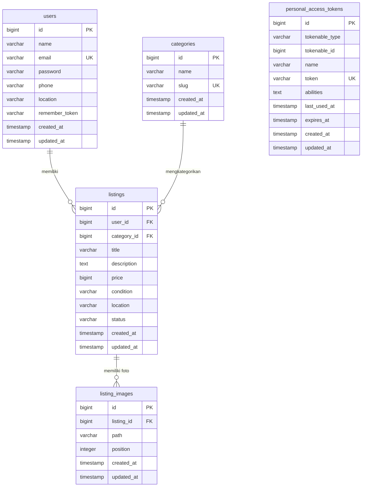

# Desain & Skema Basis Data

Dokumen ini menjelaskan struktur data relasional, Entity Relationship Diagram (ERD), kolom-kolom penting, serta strategi pengindeksan pada basis data **PostgreSQL 16**.

---

## 1. Entity Relationship Diagram (ERD)

Diagram ERD berikut memetakan seluruh tabel yang terdapat pada sistem:

---

## 2. Struktur Tabel & Field Penting

### A. Tabel: `users`
Menyimpan akun pengguna terdaftar (penjual dan pembeli).

| Nama Kolom | Tipe Data | Nullable | Keterangan & Aturan |
|---|---|---|---|
| `id` | `bigint` (Auto Increment) | NO | Primary Key. Identitas unik pengguna. |
| `name` | `varchar(255)` | NO | Nama lengkap pengguna untuk tampilan publik. |
| `email` | `varchar(255)` | NO | Unique. Alamat surel untuk kredensial login. |
| `password` | `varchar(255)` | NO | Hash kata sandi terenkripsi (Argon2id/Bcrypt). |
| `phone` | `varchar(255)` | NO | Nomor WhatsApp aktif (format internasional `628...`). |
| `location` | `varchar(255)` | NO | Kota / daerah domisili pengguna (misal: "Bandung, Jawa Barat"). |
| `remember_token` | `varchar(100)` | YES | Token sesi "Ingat Saya" bawaan Laravel. |
| `created_at` | `timestamp` | YES | Waktu pendaftaran akun (ditampilkan sebagai "Bergabung sejak"). |
| `updated_at` | `timestamp` | YES | Waktu pembaruan profil pengguna. |

### B. Tabel: `categories`
Menyimpan taksonomi kategori barang bekas (dikelola melalui seeder).

| Nama Kolom | Tipe Data | Nullable | Keterangan & Aturan |
|---|---|---|---|
| `id` | `bigint` (Auto Increment) | NO | Primary Key. Identitas unik kategori. |
| `name` | `varchar(255)` | NO | Nama kategori yang tampil di UI (contoh: "Perkakas & Otomotif"). |
| `slug` | `varchar(255)` | NO | Unique. Identifier URL-friendly (contoh: `perkakas-otomotif`). |
| `created_at` | `timestamp` | YES | Waktu pembuatan kategori. |
| `updated_at` | `timestamp` | YES | Waktu pembaruan kategori. |

### C. Tabel: `listings`
Tabel entitas utama yang memuat data barang bekas yang dipasang.

| Nama Kolom | Tipe Data | Nullable | Keterangan & Aturan |
|---|---|---|---|
| `id` | `bigint` (Auto Increment) | NO | Primary Key. Identitas unik barang. |
| `user_id` | `bigint` (Foreign Key) | NO | Relasi ke `users.id` (`ON DELETE CASCADE`). Pemilik barang. |
| `category_id` | `bigint` (Foreign Key) | NO | Relasi ke `categories.id` (`ON DELETE CASCADE`). Kategori barang. |
| `title` | `varchar(255)` | NO | Judul barang yang dicari pengguna (diindeks Trigram). |
| `description` | `text` | NO | Deskripsi detail kondisi, alasan jual, dan kelengkapan barang. |
| `price` | `unsignedBigInteger` | NO | Nilai harga barang dalam satuan Rupiah bulat. |
| `condition` | `varchar(255)` | NO | Status kondisi barang (`new`, `like_new`, `good`, `fair`). |
| `location` | `varchar(255)` | NO | Lokasi COD / pengambilan barang (misal: "Tebet, Jakarta Selatan"). |
| `status` | `varchar(255)` | NO | Status ketersediaan barang (`available` atau `sold`). Default: `available`. |
| `created_at` | `timestamp` | YES | Waktu pemasangan iklan barang. Digunakan untuk sorting terbaru. |
| `updated_at` | `timestamp` | YES | Waktu pembaruan barang atau perubahan status. |

### D. Tabel: `listing_images`
Menyimpan galeri foto berkas (1 barang dapat memiliki 0 hingga 5 foto).

| Nama Kolom | Tipe Data | Nullable | Keterangan & Aturan |
|---|---|---|---|
| `id` | `bigint` (Auto Increment) | NO | Primary Key. Identitas unik berkas foto. |
| `listing_id` | `bigint` (Foreign Key) | NO | Relasi ke `listings.id` (`ON DELETE CASCADE`). |
| `path` | `varchar(255)` | NO | Path relatif penyimpanan berkas (contoh: `listings/uuid.webp`). |
| `position` | `unsignedInteger` | NO | Urutan tampilan foto (default `0`). Posisi 0 bertindak sebagai cover/foto utama. |
| `created_at` | `timestamp` | YES | Waktu pengunggahan foto. |
| `updated_at` | `timestamp` | YES | Waktu pembaruan rekaman foto. |

### E. Tabel: `personal_access_tokens`
Disediakan oleh generator `php artisan install:api` Laravel 12. Dicatat dalam ADR-010 sebagai tabel cadangan untuk integrasi mobile native di masa depan, saat ini tidak digunakan pada alur web SPA cookie.

---

## 3. Strategi Indexing & Alasan Teknis

Seluruh indeks dibuat secara presisi untuk mengoptimalkan pola kueri akses tertinggi:

| Nama Indeks | Tabel | Definisi Kolom | Tipe Indeks | Alasan Teknis & Kasus Penggunaan |
|---|---|---|---|---|
| `listings_title_trgm_idx` | `listings` | `title gin_trgm_ops` | **GIN (Trigram)** | Mengoptimalkan pencarian parsial teks (`ILIKE '%keyword%'`) via ekstensi PostgreSQL `pg_trgm`. Menghindari *full table scan* dan memberikan pencarian instan pada ratusan ribu data. |
| `listings_status_category_id_created_at_index` | `listings` | `(status, category_id, created_at)` | **B-Tree (Composite)** | Mengoptimalkan kueri utama beranda: menyaring barang yang masih tersedia (`status = 'available'`), memfilter kategori tertentu, dan mengurutkan berdasarkan waktu terbaru (`created_at DESC`) dalam satu kali traversal indeks. |
| `listings_user_id_index` | `listings` | `(user_id)` | **B-Tree** | Mempercepat kueri relasi pada halaman "Listing Saya" (`/me/listings`) dan profil publik penjual (`/users/:id`), serta operasi cascading delete. |
| `listing_images_listing_id_position_index` | `listing_images` | `(listing_id, position)` | **B-Tree (Composite)** | Menjamin pengambilan galeri foto barang terurut berdasarkan posisi urutan secara instan, terutama untuk mengambil foto cover (posisi 0) pada kueri grid listing. |
| `users_email_unique` | `users` | `(email)` | **B-Tree (Unique)** | Menjamin integritas tidak adanya duplikasi alamat surel dan mempercepat verifikasi kredensial login pengguna. |
| `categories_slug_unique` | `categories` | `(slug)` | **B-Tree (Unique)** | Mempercepat pembacaan filter kategori berdasarkan parameter slug URL (contoh: `/listings?category=elektronik`). |
