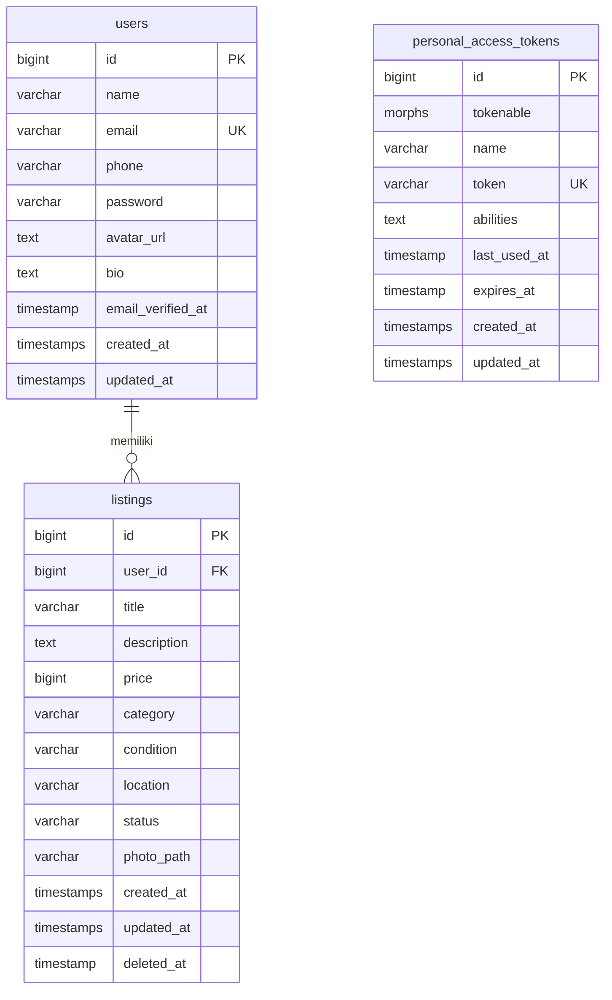

# Skema Database

Database: **PostgreSQL 16**

> Skema ini akan diimplementasikan melalui Laravel migrations di Fase 1.

---

## ERD (Entity Relationship Diagram)

---

## Tabel: `users`

| Kolom | Tipe | Nullable | Keterangan |
|-------|------|----------|-----------|
| `id` | `bigint` | NO | Primary key, auto-increment |
| `name` | `varchar(255)` | NO | Nama lengkap |
| `email` | `varchar(255)` | NO | Unique, untuk login |
| `phone` | `varchar(20)` | YES | Nomor WhatsApp (tanpa +62, misal: 081234567890) |
| `password` | `varchar(255)` | NO | Bcrypt hash |
| `avatar_url` | `text` | YES | URL foto profil |
| `bio` | `text` | YES | Deskripsi singkat penjual |
| `email_verified_at` | `timestamp` | YES | Verifikasi email (future) |
| `remember_token` | `varchar(100)` | YES | Laravel remember me |
| `created_at` | `timestamp` | NO | — |
| `updated_at` | `timestamp` | NO | — |

**Indeks**: `email` (unique)

---

## Tabel: `listings`

| Kolom | Tipe | Nullable | Keterangan |
|-------|------|----------|-----------|
| `id` | `bigint` | NO | Primary key, auto-increment |
| `user_id` | `bigint` | NO | FK → users.id |
| `title` | `varchar(255)` | NO | Nama barang |
| `description` | `text` | NO | Deskripsi barang |
| `price` | `bigint` | NO | Harga dalam rupiah (integer, bukan decimal) |
| `category` | `varchar(100)` | NO | Kategori: Elektronik, Pakaian, Olahraga, dll |
| `condition` | `varchar(10)` | NO | `new` atau `used` |
| `location` | `varchar(255)` | NO | Kota/area penjual |
| `status` | `varchar(20)` | NO | `available` atau `sold` (default: `available`) |
| `photo_path` | `varchar(255)` | YES | Path relatif di storage |
| `created_at` | `timestamp` | NO | — |
| `updated_at` | `timestamp` | NO | — |
| `deleted_at` | `timestamp` | YES | Soft delete |

**Indeks**:
- `user_id` (foreign key)
- `status` (filter)
- `category` (filter)
- `condition` (filter)
- GIN index pada `title` dan `description` via `pg_trgm` untuk search

---

## Kategori Barang

Kategori disimpan sebagai string (bukan tabel terpisah) untuk fleksibilitas MVP:

- Elektronik
- Pakaian
- Olahraga
- Rumah Tangga
- Kendaraan
- Buku & Alat Tulis
- Mainan & Hobi
- Lainnya

---

## Migrasi

Urutan file migration Laravel:

1. `create_users_table` (default Laravel)
2. `create_personal_access_tokens_table` (Sanctum)
3. `create_listings_table`
4. `add_pg_trgm_extension` (enable ekstensi PostgreSQL)
5. `add_trgm_indexes_to_listings` (GIN index untuk search)

---

## Catatan Teknis

- Harga disimpan sebagai `bigint` (bukan `decimal`) karena semua transaksi dalam rupiah bulat — hindari masalah floating point.
- `photo_path` menyimpan path relatif dari `storage/app/public`, bukan URL lengkap — URL di-generate via `Storage::url()`.
- Soft delete pada `listings` agar riwayat dapat di-audit dan data tidak hilang permanen.
- Tidak ada tabel `categories` terpisah di MVP — cukup enum/string. Jika kategori perlu multilevel atau attribute berbeda per kategori, pertimbangkan tabel categories di future work.
