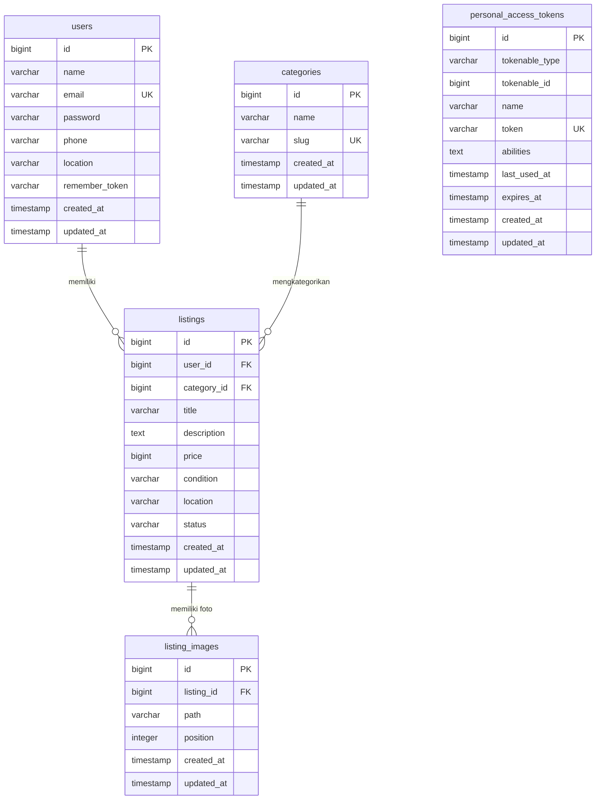

# Skema Database

Database: **PostgreSQL 16**

Seluruh skema diimplementasikan melalui Laravel 12 migrations dengan optimasi query index (composite index & GIN pg_trgm).

---

## ERD (Entity Relationship Diagram)

---

## Tabel: `users`

| Kolom | Tipe | Nullable | Keterangan |
|-------|------|----------|-----------|
| `id` | `bigint` | NO | Primary key, auto-increment |
| `name` | `varchar(255)` | NO | Nama lengkap pengguna |
| `email` | `varchar(255)` | NO | Unique, kredensial login |
| `password` | `varchar(255)` | NO | Hash password (bcrypt) |
| `phone` | `varchar(255)` | NO | Nomor WhatsApp (format 62xxxxxxxxxx) |
| `location` | `varchar(255)` | NO | Lokasi / kota domisili pengguna |
| `remember_token` | `varchar(100)` | YES | Token remember me Laravel |
| `created_at` | `timestamp` | YES | Waktu pendaftaran |
| `updated_at` | `timestamp` | YES | Waktu pembaruan profil |

**Indeks**:
- `users_pkey`: Primary key (`id`)
- `users_email_unique`: Unique index (`email`)

---

## Tabel: `categories`

| Kolom | Tipe | Nullable | Keterangan |
|-------|------|----------|-----------|
| `id` | `bigint` | NO | Primary key, auto-increment |
| `name` | `varchar(255)` | NO | Nama kategori (mis. Sepeda, Perkakas) |
| `slug` | `varchar(255)` | NO | Unique slug URL-friendly |
| `created_at` | `timestamp` | YES | Waktu dibuat |
| `updated_at` | `timestamp` | YES | Waktu diperbarui |

**Indeks**:
- `categories_pkey`: Primary key (`id`)
- `categories_slug_unique`: Unique index (`slug`)

---

## Tabel: `listings`

| Kolom | Tipe | Nullable | Keterangan |
|-------|------|----------|-----------|
| `id` | `bigint` | NO | Primary key, auto-increment |
| `user_id` | `bigint` | NO | FK → `users.id` (cascade on delete) |
| `category_id` | `bigint` | NO | FK → `categories.id` (cascade on delete) |
| `title` | `varchar(255)` | NO | Judul barang bekas |
| `description` | `text` | NO | Deskripsi lengkap, kondisi & riwayat |
| `price` | `bigint` | NO | Harga dalam Rupiah (tanpa desimal) |
| `condition` | `varchar(255)` | NO | Backed Enum: `new`, `like_new`, `good`, `fair` |
| `location` | `varchar(255)` | NO | Lokasi barang / penjual |
| `status` | `varchar(255)` | NO | Backed Enum: `available`, `sold` (default: `available`) |
| `created_at` | `timestamp` | YES | Waktu dibuat |
| `updated_at` | `timestamp` | YES | Waktu diperbarui |

**Indeks**:
- `listings_pkey`: Primary key (`id`)
- `listings_user_id_index`: B-Tree index pada `user_id` (filter listing milik user)
- `listings_status_category_id_created_at_index`: Composite B-Tree index `(status, category_id, created_at)` untuk sorting & filter katalog
- `listings_title_trgm_idx`: GIN index via `pg_trgm` (`gin (title gin_trgm_ops)`) untuk pencarian full-text / substring `ILIKE` super cepat

---

## Tabel: `listing_images`

| Kolom | Tipe | Nullable | Keterangan |
|-------|------|----------|-----------|
| `id` | `bigint` | NO | Primary key, auto-increment |
| `listing_id` | `bigint` | NO | FK → `listings.id` (cascade on delete) |
| `path` | `varchar(255)` | NO | Path relatif storage atau URL gambar dummy |
| `position` | `integer` | NO | Urutan tampilan foto (default: `0`) |
| `created_at` | `timestamp` | YES | Waktu dibuat |
| `updated_at` | `timestamp` | YES | Waktu diperbarui |

**Indeks**:
- `listing_images_pkey`: Primary key (`id`)
- `listing_images_listing_id_position_index`: Composite index `(listing_id, position)`

---

## Tabel: `personal_access_tokens`

Tabel bawaan Laravel Sanctum untuk opsi fallback token API jika dibutuhkan.

---

## 8 Kategori Standar (Seeded)

1. **Sepeda** (`sepeda`)
2. **Perkakas** (`perkakas`)
3. **Hobi** (`hobi`)
4. **Elektronik** (`elektronik`)
5. **Rumah Tangga** (`rumah-tangga`)
6. **Otomotif** (`otomotif`)
7. **Olahraga** (`olahraga`)
8. **Lainnya** (`lainnya`)
