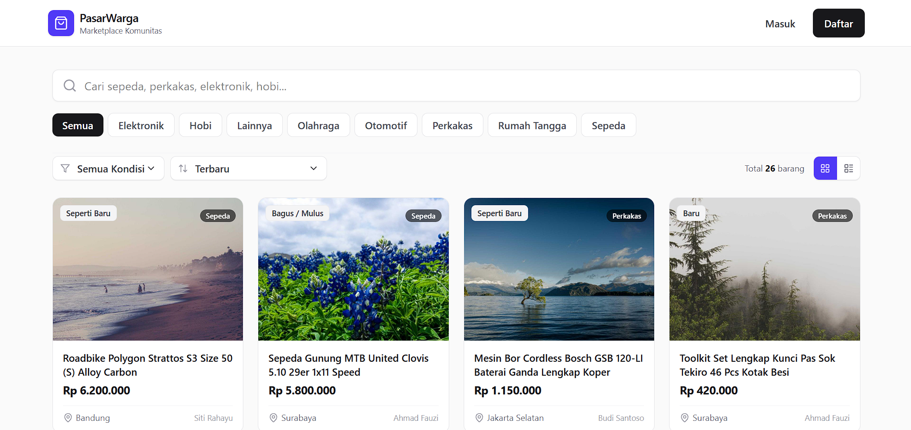
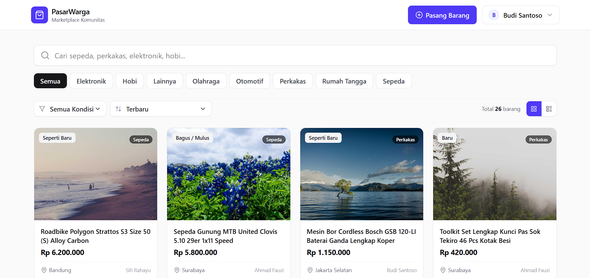
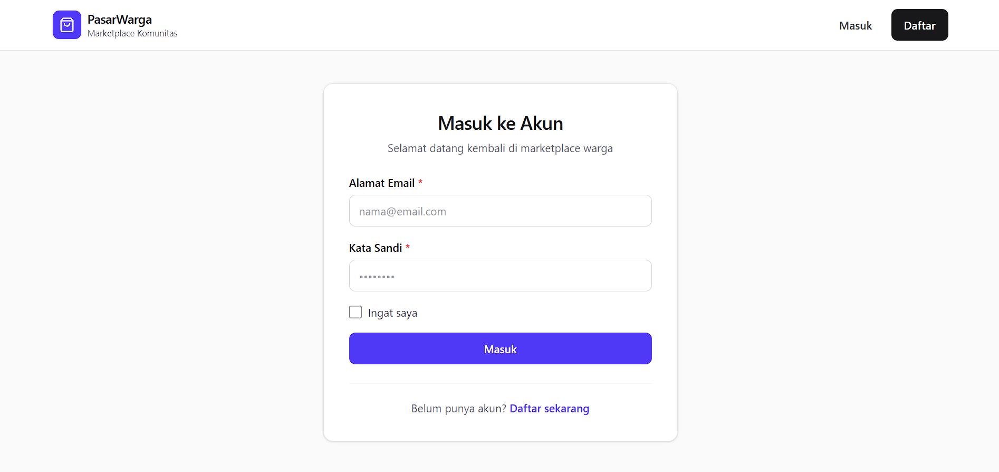
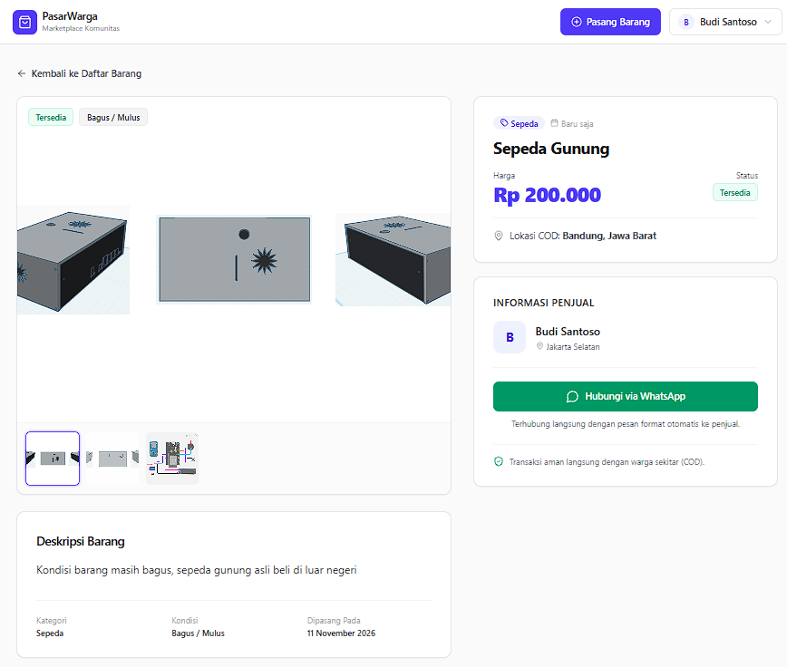
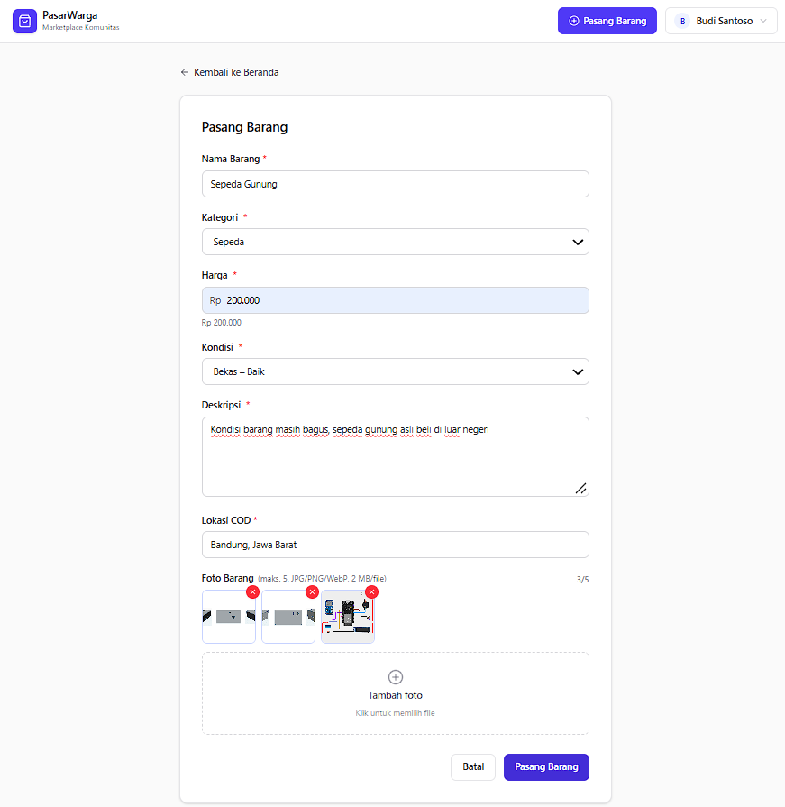
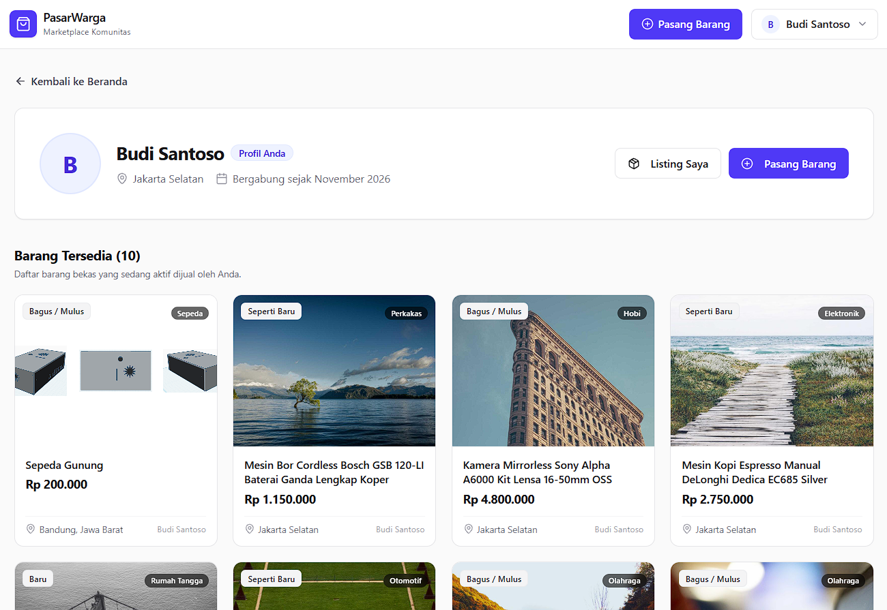
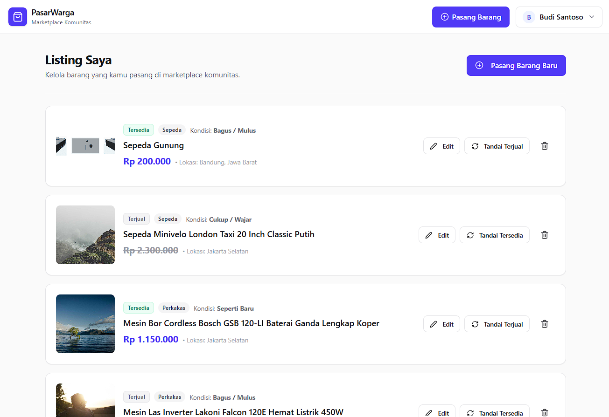

# Tangkapan Layar Aplikasi (Screenshots)

Dokumen ini memuat bukti visual antarmuka pengguna (UI) dari aplikasi PasarWarga yang telah berhasil diimplementasikan sesuai dengan persyaratan *Minimum Viable Product* (MVP).

---

## 1. Beranda (Katalog Barang)
Halaman utama yang menampilkan daftar barang bekas. Pengguna dapat melihat galeri barang (dalam mode grid), melakukan pencarian, serta memfilter berdasarkan kategori dan kondisi.

### Tampilan Sebelum Login (Guest)

### Tampilan Setelah Login (Authenticated)

---

## 2. Autentikasi Pengguna
Halaman formulir masuk (Login) dan daftar akun (Register) yang diamankan menggunakan proteksi CSRF dan otentikasi SPA Cookie dari Laravel Sanctum.

---

## 3. Detail Barang & Kontak
Halaman rincian barang yang memuat deskripsi lengkap, kondisi, galeri foto, harga, serta informasi penjual. Dilengkapi dengan tombol **Hubungi via WhatsApp** yang terintegrasi langsung dengan API `wa.me`.

---

## 4. Pasang Barang Baru
Formulir dinamis untuk menambahkan barang (listing) baru ke dalam marketplace. Mendukung unggahan (*upload*) multi-foto dengan pratinjau (*preview*) otomatis sebelum dikirim ke server.

---

## 5. Profil Penjual (Public View)
Halaman profil publik yang dapat dilihat oleh calon pembeli. Menampilkan informasi dasar penjual dan daftar semua barang aktif yang sedang dijual oleh pengguna tersebut.

---

## 6. Kelola Listing (Manajemen Inventaris)
Halaman panel kontrol pribadi (My Listings) bagi pengguna untuk mengelola barang dagangannya. Pengguna memiliki akses langsung (Action Buttons) untuk **Mengedit**, **Menghapus**, dan mengubah status visibilitas barang menjadi **Tersedia** atau **Terjual**.

